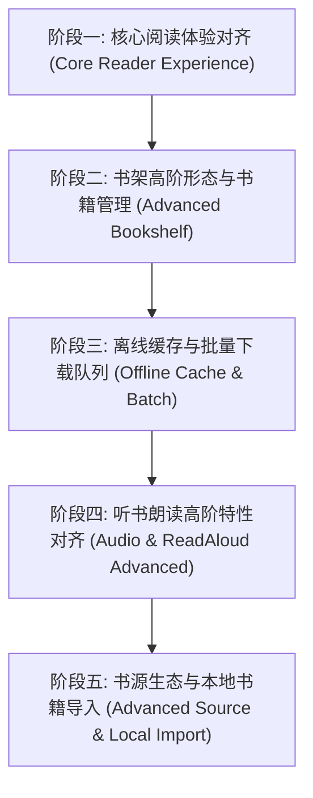

# Legado iOS 对齐 Legado (Material Design 3) 全局长期规划与任务矩阵

本文档对标本地 Android 原生参考项目 [`/Users/theliser/code/legado-with-MD3`](file:///Users/theliser/code/legado-with-MD3) 的功能实现、架构规范与历史演进，制定 iOS 原生版本的长期对齐规划。

---

## 一、双轨留档与任务跟踪机制

本项目采用 **本地版本树留档 + GitHub Issues 云端追踪** 的双轨留档方案：
1. **本地代码库持久留档**：
   - 宏观路线图保存在 `docs/roadmap/LEGADO_MD3_ALIGNMENT_MASTER_PLAN.md`；
   - 随代码版本迭代实时同步，保证工程具备脱离云端的完整可追溯性。
2. **GitHub Issues 状态联动**：
   - 每个主阶段（Epic）和核心特性在 GitHub 创建结构化 Issue；
   - 规范标签体系：`epic`, `reader`, `bookshelf`, `source-engine`, `audio-tts`, `offline-cache`；
   - 所有 Git 提交遵循 Conventional Commits 并通过 `Refs #<ID>` 或 `Closes #<ID>` 关联对应 Issue。

---

## 二、架构与设计约束（最高铁律）

1. **架构模式**：展示层强制 **MVI (Model-View-Intent)**，所有状态唯一收敛于 `ViewState`，所有操作通过 `ViewIntent` 发送；
2. **业务分层**：业务逻辑下沉于 `Domain/UseCases`，视图层（View）**零业务逻辑**；
3. **视觉风格**：**严禁 Android Material 风格移植**。全面遵循 **Apple 官方液态玻璃（Liquid Glass）规范**：
   - 材质使用系统 `.ultraThinMaterial` / `.thinMaterial`；
   - 按钮必须使用 `GlassButtonStyle` / `GlassProminentButtonStyle` 或 `.buttonStyle(.borderedProminent)`；
   - 采用亚像素微描边与连续平滑圆角（Continuous Corner Radius）；
   - 保障 NavigationBar 与 TabBar 内容穿透与滚动边缘折射光效（杜绝根容器大面积硬色背景）。

---

## 三、五大核心阶段任务规划 (Roadmap)

---

### 阶段一：核心阅读体验深度对齐 (Core Reader Experience)
> **对标 MD3 模块**：`ui/book/changesource/`, `ui/book/read/`, `ui/book/searchContent/`, `ui/book/bookmark/`

- [x] **1.1 多源聚合一键换源 (Change Source MVI)** (已完成，Commit: `0192a34`)
  - 对标文件：`ChangeSourceActivity.kt`, `ChangeSourceViewModel.kt`
  - 核心功能：
    - 在书籍详情页与阅读器 HUD 中提供「换源」快捷入口；
    - 基于书名与作者，异步并发检索所有已启用的可用书源；
    - 展示各书源最新章节、更新时间、响应延迟并支持排序与权重对比；
    - 选定目标书源后，自动重映射阅读章节与进度，平滑切换正文源。
- [x] **1.2 多翻页动效引擎 (Reading Page Turn Animation Modes)** (已完成，Commit: `22a98fd`)
  - 对标文件：`CoverPageAnim.kt`, `SlidePageAnim.kt`, `ScrollPageAnim.kt`
  - 核心功能：
    - 支持「覆盖翻页 (Cover)」、「水平平滑滑动 (Slide)」、「上下连续滚动 (Vertical Scroll)」切换；
    - 结合 CoreText 排版引擎适配连续滚动模式。
- [x] **1.3 正文内容全文搜索与定位 (Search in Book Content)** (已完成，Commit: `948159b`)
  - 对标文件：`SearchContentActivity.kt`
  - 核心功能：
    - 在阅读器内部搜索关键词，列出包含关键字的章节、上下文摘录与段落；
    - 点击匹配项瞬时跳转至正文对应位置并精确定位。
- [x] **1.4 书签与划线笔记标注系统 (Bookmarks & Highlights)** (已完成，Commit: `e19a1e8`)
  - 对标文件：`data/entities/Bookmark.kt`, `ui/book/bookmark/`
  - 核心功能：
    - SwiftData `BookmarkEntity` 增删查改持久化；
    - 阅读器 HUD 实时书签联动与一键添加/取消；
    - 目录侧栏 (`BookTocSheet`) 分段集成「目录/书签」双视图，支持一键定位与滑动删除。

---

### 阶段二：书架高阶形态与书籍管理对齐 (Advanced Bookshelf & Library)
> **对标 MD3 模块**：`ui/book/group/`, `ui/book/manage/`, `data/entities/BookGroup.kt`

- [x] **2.1 书架分组体系 (Bookshelf Grouping MVI)** (已完成，Commit: `1f9fd9a`)
  - 对标文件：`BookGroup.kt`, `GroupManageActivity.kt`
  - 核心功能：
    - 支持系统内置分组（全部、未读、在读、完结）与用户自定义分组增删改查；
    - 书架顶部提供液态玻璃分组胶囊标签切换；
    - 数据库模型 `BookGroupEntity` SwiftData 存储与 Repository 驱动；
    - 支持书籍单选/批量修改分组归属。
- [x] **2.2 宫格封面与列表双视图切换 (Grid & List View Switcher)** (已完成，Commit: `1f9fd9a`)
  - 核心功能：
    - 顶部工具栏切换 3 列自适应瀑布流宫格封面卡片与详尽列表；
    - 异步高保真书籍封面加载与无封面时的优雅 Liquid Glass 默认排版；
    - 卡片配备平滑连续圆角、微光亚像素描边与未读/进度/更新红点徽标。
- [x] **2.3 批量管理与全书架目录检查更新 (Batch Management & Update Check)** (已完成，Commit: `1f9fd9a`)
  - 对标文件：`BookshelfManageActivity.kt`
  - 核心功能：
    - 批量模式：顶栏一键进入「管理」模式，多选批量移出书架、批量更换分组；
    - 底部采用 Liquid Glass 悬浮药丸操作栏 (`BookshelfBatchBar`)；
    - 智能更新：书架下拉刷新一键并发检查所有书籍最新章节，更新徽标红点提醒。

---

### 阶段三：离线缓存与批量下载队列 (Offline Caching & Batch Downloader)
> **对标 MD3 模块**：`ui/book/cache/`, `service/CacheService.kt`

- [ ] **3.1 离线章节并发下载管理器 (Batch Chapter Downloader)**
  - 对标文件：`CacheActivity.kt`, `CacheService.kt`
  - 核心功能：
    - 支持快捷选项：下载后 50 章、后 100 章、全部未读章节、全本整本缓存；
    - 基于 `AsyncSemaphore` 的多通道并发安全下载，支持暂停、恢复与失败重试；
    - 提供液态玻璃下载浮动进度指示器。
- [ ] **3.2 离线存储空间管理与清理**
  - 统计各书籍离线缓存占用体积（MB/KB），支持单本或一键清理全部离线正文。

---

### 阶段四：听书朗读高阶特性对齐 (Audio & ReadAloud Advanced)
> **对标 MD3 模块**：`ui/book/readaloud/`, `service/AudioPlayService.kt`

- [ ] **4.1 定时关闭与睡眠倒计时 (Sleep Timer)**
  - 核心功能：
    - 支持快捷设置：15 分钟、30 分钟、60 分钟、90 分钟、播完当前章停止；
    - 倒计时结束平滑淡出音量停止朗读。
- [ ] **4.2 系统锁屏媒体中心与控制中心联动 (Now Playing & Remote Commands)**
  - 接入 `MPNowPlayingInfoCenter` 与 `MPRemoteCommandCenter`；
  - 锁屏封面、书名、章节进度实时展示，支持耳机线控与锁屏播放/暂停/上一章/下一章。
- [ ] **4.3 语速与音色微调**
  - 支持 0.5x ~ 2.0x 语速调节与语调微调。

---

### 阶段五：书源生态、高级规则与本地书籍导入 (Advanced Source & Local Import)
> **对标 MD3 模块**：`ui/book/source/`, `ui/file/`, `ui/login/`

- [ ] **5.1 书源批量网络订阅与有效性体检**
  - 支持直接填入书源网络合集 URL，一键解析批量导入；
  - 批量可用性探测体检，标记失效或超时书源。
- [ ] **5.2 书源分组管理**
  - 对标 MD3 书源精选、有声、发现、漫画分组管理与过滤。
- [ ] **5.3 本地书籍导入 (TXT 智能目录切分 / EPUB)**
  - 对标文件：`TxtTocRule.kt`, `ImportBookActivity.kt`
  - 支持通过系统文件选择器导入本地 TXT/EPUB 文件，自动智能正则分卷与目录解析。

---

## 四、执行排期与第一步实施目标

按照用户指示，先制定完整方案，然后立即开始执行：
- **首要实施目标**：启动 **阶段一（1.1 多源聚合一键换源 Change Source MVI）** 的开发；
- **落地步骤**：
  1. 在 GitHub 创建对应的 Phase 1 追踪 Issue；
  2. 新建分支 `feature/change-source-mvi`；
  3. 实现 `SearchBooksUseCase` 聚合检索同名同作者书籍能力；
  4. 构建 `ChangeSourceViewModel`、`ChangeSourceState`、`ChangeSourceIntent`、`ChangeSourceSheet`（液态玻璃半屏弹窗）；
  5. 接入书籍详情页与阅读器 HUD；
  6. 编写单元测试并验证 `make test` 与 `make format-check`。
