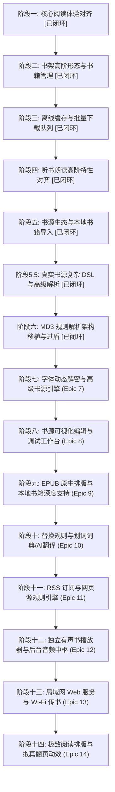

# Legado iOS 对齐 Legado (Material Design 3) 全局长期规划与任务矩阵

本文档对标本地 Android 原生参考项目 [`/Users/theliser/code/legado-with-MD3`](file:///Users/theliser/code/legado-with-MD3) 的功能实现、架构规范与历史演进，制定 iOS 原生版本的长期对齐规划。

---

## 一、双轨留档与任务跟踪机制

本项目采用 **本地版本树留档 + GitHub Issues 云端追踪** 的双轨留档方案：
1. **本地代码库持久留档**：
   - 宏观路线图保存在 `docs/roadmap/LEGADO_MD3_ALIGNMENT_MASTER_PLAN.md`；
   - 随代码版本迭代实时同步，保证工程具备脱离云端的完整可追溯性。
2. **GitHub Issues 状态联动**：
   - 每个主阶段（Epic）和核心特性在 GitHub 创建结构化 Issue；
   - 规范标签体系：`epic`, `reader`, `bookshelf`, `source-engine`, `audio-tts`, `offline-cache`；
   - 所有 Git 提交遵循 Conventional Commits 并通过 `Refs #<ID>` 或 `Closes #<ID>` 关联对应 Issue。

---

## 二、架构与设计约束（最高铁律）

1. **架构模式**：展示层强制 **MVI (Model-View-Intent)**，所有状态唯一收敛于 `ViewState`，所有操作通过 `ViewIntent` 发送；
2. **业务分层**：业务逻辑下沉于 `Domain/UseCases`，视图层（View）**零业务逻辑**；
3. **视觉风格**：**严禁 Android Material 风格移植**。全面遵循 **Apple 官方液态玻璃（Liquid Glass）规范**：
   - 材质使用系统 `.ultraThinMaterial` / `.thinMaterial`；
   - 按钮必须使用 `GlassButtonStyle` / `GlassProminentButtonStyle` 或 `.buttonStyle(.borderedProminent)`；
   - 采用亚像素微描边与连续平滑圆角（Continuous Corner Radius）；
   - 保障 NavigationBar 与 TabBar 内容穿透与滚动边缘折射光效（杜绝根容器大面积硬色背景）。

---

## 三、五大核心阶段任务规划 (Roadmap)

---

### 阶段一：核心阅读体验深度对齐 (Core Reader Experience)
> **对标 MD3 模块**：`ui/book/changesource/`, `ui/book/read/`, `ui/book/searchContent/`, `ui/book/bookmark/`

- [x] **1.1 多源聚合一键换源 (Change Source MVI)** (已完成，Commit: `0192a34`)
  - 对标文件：`ChangeSourceActivity.kt`, `ChangeSourceViewModel.kt`
  - 核心功能：
    - 在书籍详情页与阅读器 HUD 中提供「换源」快捷入口；
    - 基于书名与作者，异步并发检索所有已启用的可用书源；
    - 展示各书源最新章节、更新时间、响应延迟并支持排序与权重对比；
    - 选定目标书源后，自动重映射阅读章节与进度，平滑切换正文源。
- [x] **1.2 多翻页动效引擎 (Reading Page Turn Animation Modes)** (已完成，Commit: `22a98fd`)
  - 对标文件：`CoverPageAnim.kt`, `SlidePageAnim.kt`, `ScrollPageAnim.kt`
  - 核心功能：
    - 支持「覆盖翻页 (Cover)」、「水平平滑滑动 (Slide)」、「上下连续滚动 (Vertical Scroll)」切换；
    - 结合 CoreText 排版引擎适配连续滚动模式。
- [x] **1.3 正文内容全文搜索与定位 (Search in Book Content)** (已完成，Commit: `948159b`)
  - 对标文件：`SearchContentActivity.kt`
  - 核心功能：
    - 在阅读器内部搜索关键词，列出包含关键字的章节、上下文摘录与段落；
    - 点击匹配项瞬时跳转至正文对应位置并精确定位。
- [x] **1.4 书签与划线笔记标注系统 (Bookmarks & Highlights)** (已完成，Commit: `e19a1e8`)
  - 对标文件：`data/entities/Bookmark.kt`, `ui/book/bookmark/`
  - 核心功能：
    - SwiftData `BookmarkEntity` 增删查改持久化；
    - 阅读器 HUD 实时书签联动与一键添加/取消；
    - 目录侧栏 (`BookTocSheet`) 分段集成「目录/书签」双视图，支持一键定位与滑动删除。

---

### 阶段二：书架高阶形态与书籍管理对齐 (Advanced Bookshelf & Library)
> **对标 MD3 模块**：`ui/book/group/`, `ui/book/manage/`, `data/entities/BookGroup.kt`

- [x] **2.1 书架分组体系 (Bookshelf Grouping MVI)** (已完成，Commit: `1f9fd9a`)
  - 对标文件：`BookGroup.kt`, `GroupManageActivity.kt`
  - 核心功能：
    - 支持系统内置分组（全部、未读、在读、完结）与用户自定义分组增删改查；
    - 书架顶部提供液态玻璃分组胶囊标签切换；
    - 数据库模型 `BookGroupEntity` SwiftData 存储与 Repository 驱动；
    - 支持书籍单选/批量修改分组归属。
- [x] **2.2 宫格封面与列表双视图切换 (Grid & List View Switcher)** (已完成，Commit: `1f9fd9a`)
  - 核心功能：
    - 顶部工具栏切换 3 列自适应瀑布流宫格封面卡片与详尽列表；
    - 异步高保真书籍封面加载与无封面时的优雅 Liquid Glass 默认排版；
    - 卡片配备平滑连续圆角、微光亚像素描边与未读/进度/更新红点徽标。
- [x] **2.3 批量管理与全书架目录检查更新 (Batch Management & Update Check)** (已完成，Commit: `1f9fd9a`)
  - 对标文件：`BookshelfManageActivity.kt`
  - 核心功能：
    - 批量模式：顶栏一键进入「管理」模式，多选批量移出书架、批量更换分组；
    - 底部采用 Liquid Glass 悬浮药丸操作栏 (`BookshelfBatchBar`)；
    - 智能更新：书架下拉刷新一键并发检查所有书籍最新章节，更新徽标红点提醒。

---

### 阶段三：离线缓存与批量下载队列 (Offline Caching & Batch Downloader)
> **对标 MD3 模块**：`ui/book/cache/`, `service/CacheService.kt`

- [x] **3.1 离线章节并发下载管理器 (Batch Chapter Downloader)** (已完成，Commit: `e228bb0`)
  - 对标文件：`CacheActivity.kt`, `CacheService.kt`
  - 核心功能：
    - 支持快捷选项：下载后 50 章、后 100 章、全部未读章节、全本整本缓存；
    - 基于 `AsyncSemaphore` 的多通道并发安全下载，支持暂停、恢复与失败重试；
    - 提供液态玻璃下载浮动进度指示器与 `BookCacheSheet` 原生模态交互。
- [x] **3.2 离线存储空间管理与清理** (已完成，Commit: `e228bb0`)
  - 统计各书籍离线缓存占用体积（MB/KB），沙盒统一规整为 `Caches/LegadoChapters/<safeBookName>/<index>.txt`，支持单本或一键清理全部离线正文；
  - 设置中心集成离线存储占用展示与一键清空能力。

---

### 阶段四：听书朗读高阶特性对齐 (Audio & ReadAloud Advanced)
> **对标 MD3 模块**：`ui/book/readaloud/`, `service/AudioPlayService.kt`

- [x] **4.1 定时关闭与睡眠倒计时 (Sleep Timer)** (已完成，Commit: `9e57ee4`)
  - 核心功能：
    - 支持快捷设置：15 分钟、30 分钟、45 分钟、60 分钟、90 分钟、120 分钟及滑块微调；
    - 章节定时：1、2、3、5、8、10 章自动倒数；
    - 「读完本章再停」(`finishCurrentChapterAfterTimer`) 选项，到点后不掐断，读完当前章停止；
    - 「渐弱停止」(`isFadeOutEnabled`) 选项：倒计时最后 10 秒音量平滑线性淡出。
- [x] **4.2 系统锁屏媒体中心与控制中心联动 (Now Playing & Remote Commands)** (已完成，Commit: `9e57ee4`)
  - 接入 `MPNowPlayingInfoCenter` 与 `MPRemoteCommandCenter`；
  - 锁屏封面、书名、章节进度实时展示，支持耳机线控与锁屏播放/暂停/上一句/下一句/快进快退 15 秒/进度条拖拽 Scrubber 寻句；
  - 监听音频会话中断（来电/Siri）与耳机插拔（拔出自动暂停）。
- [x] **4.3 语速、音色微调与朗读进度高亮追踪** (已完成，Commit: `9e57ee4`)
  - 支持 0.5x ~ 2.0x 语速调节与 0.5 ~ 1.5 语调微调；
  - 检索系统全部语音并优先置顶中文角色，设置通过 `TTSConfig` 自动持久化；
  - 阅读器正文逐句高亮同步追踪 (`highlightedSentence`)，句子超出范围自动翻页，跨章自动无缝连续朗读；
  - 配合原生液态玻璃面板 `TTSControlSheet` 与胶囊悬浮栏 `TTSFloatingBar`。

---

### 阶段五：书源生态、高级规则与本地书籍导入 (Advanced Source & Local Import)
> **对标 MD3 模块**：`ui/book/source/`, `ui/file/`, `model/analyzeRule/`

- [x] **5.1 真实书源底层规则引擎兼容 (XIU2 生态对齐)** (已完成，Commit: `7aa8139`, Issue #18)
  - 实现 `AnalyzeUrl.swift`，对齐 Android `AnalyzeUrl.kt`：`@js:`、`<js>`、`{{(page-1)*50}}` 表达式、单引号非标 JSON 参数及 GBK/UTF-8 编码自适应；
  - 扩展 `JSEngine+Bridge.swift` 注入完整 Legado Java bridge（`java.ajax` 同步请求、`java.get/post`、`java.put/get`、`java.hexDecodeToString`、`java.androidId`、`source/book` 上下文）；
  - `JSONPathParser` 与 `CSSSelectorParser` 升级支持 `||` 备选降级、`&&` 拼接组合、数组切片及 `##pattern##replacement` 正则清洗；
  - 覆盖 XIU2 master 书源合集测试，通过率 100%。
- [x] **5.2 书源批量网络订阅与有效性体检** (已完成，Commit: `7aa8139`, Issue #18)
  - 支持直接填入书源网络合集 URL，一键解析批量导入；
  - 并发连通性与规则有效性探测体检，输出 `SourceHealthReport` 并在顶部悬浮液态玻璃药丸展示体检进度与失效状态。
- [x] **5.3 书源分组管理** (已完成，Commit: `7aa8139`, Issue #18)
  - 对标 MD3 书源精选、有声、发现、漫画分组管理，配合液态玻璃分段胶囊栏实时过滤。
- [x] **5.4 本地书籍导入 (TXT 智能目录切分 / EPUB)** (已完成，Commit: `7aa8139`, Issue #18)
  - 对标文件：`TxtTocRule.kt`, `ImportBookActivity.kt`；
  - 接入系统 `UIDocumentPicker` 导入本地 TXT/EPUB 文件，基于智能章节正则分卷秒级生成目录并入架。
- [x] **5.5 iPadOS 18 官方液态玻璃（Liquid Glass）视觉重塑** (已完成，Commit: `7aa8139`, Issue #18)
  - `ContentView.swift` 配置 `.tabViewStyle(.sidebarAdaptable)`，使 iPad 呈现官方顶栏悬浮液态玻璃药丸与侧边栏形态；
  - 全面清除 `ExploreView`、`BookDetailView`、`SourceDebugSheet` 中的硬编码不透明背景，实现内容实时折射与微光高光。

---

### 阶段 5.5：全量真实书源复杂 DSL 与高级动态解析 (Complex Real-World Source DSL)
> **对标 MD3 模块**：`model/analyzeRule/`, `help/http/`

- [x] **5.5.1 DOMStepEvaluator 规则步进引擎** (已完成，Commit: `584965e`, Issue #19)
  - 完整支持 `@` 级联步进分词、索引与逆序切片（如 `tag.div!-1:10`）、类名/ID/子节点/文本检索；
  - XPath 智能快速降级转译为 CSS 选择器；
  - 跨脚本分支拆分，保护 `<js>` 与 `@js:` 内部逻辑运算符。
- [x] **5.5.2 JSEngine 沙箱原生能力增强** (已完成，Commit: `584965e`, Issue #19)
  - DOM 动态提取 API：`java.setContent`、`java.getString`、`java.getElements`；
  - 繁简互转：`java.t2s` / `t2s`（繁转简）与 `java.s2t` / `s2t`（简转繁）；
  - 全局快速网络与加解密：`ajax(url)`、`java.encodeURI`、`java.md5Encode`、`java.base64Encode/Decode`；
  - 变量快速存取：`java.put` / `java.get` 运行时存储池。
- [x] **5.5.3 真实书源合集（XIU2、十大灰狼、二月无雪、altergu等）测试验证** (已完成，Commit: `584965e`, Issue #19)
  - 宽容容错解码（`decodeLenientInt/Bool`），数千条书源导入零崩溃；
  - 覆盖酷我、69书吧、话本小说、哔哩轻小说等真实书源。

---

### 阶段六：深度移植 Legado MD3 规则解析器架构与全量 API 数据层测试覆盖
> **对标 MD3 模块**：`model/analyzeRule/`, `model/webBook/`, `help/http/`

- [x] **6.1 规则解析分发核心对齐 (AnalyzeRule / RuleAnalyzer)** (已完成，Commit: `9c13ec5`, Issue #20)
  - 对标 `AnalyzeRule.kt`、`RuleAnalyzer.kt`、`RuleDataInterface.kt`、`AnalyzeByRegex.kt`；
  - 完整支持规则组合器 `&&`（拼接）、`||`（备选降级）、`%%`（并列拉链）；
  - 动态模板 `{$.json.path}`、`{{ js expression }}`、正则分组捕获 `$0`~`$9`；
  - `@put:{key: rule}` 规则求值存储与 `@get:{key}` 上下文提取；
  - 子对象规则初始化 `ruleBookInfo.init`；
  - 正则清洗管道 `##pattern##replacement##replaceFirst` 与 `pattern=>replacement`。
- [x] **6.2 Cloudflare 403 交互式过盾与 Cookie 持久化** (已完成，Commit: `9c13ec5`, Issue #20)
  - `BrowserVerificationManager` 基于系统 `WKWebView` 拦截 Cloudflare 403 / Turnstile challenge；
  - 过盾成功后自动捕获 `cf_clearance` 写入持久化 `CookieStore`，并同步至 `HTTPCookieStorage` 与 `UserDefaults`；
  - JS 沙箱注入 `java.startBrowserAwait(url, title, refetch)`，返回 `StrResponse` 支持 `.body()` 与 `.url()`；
  - 自动重放挂起请求，实现真实书源过盾无缝续读。
- [x] **6.3 纯数据层全 API 单元测试覆盖** (已完成，Commit: `9c13ec5`, Issue #20)
  - `BookSourceAPITests.swift` 与 `AnalyzeRuleTests.swift` 涵盖 28 个针对性单元测试，覆盖搜索、发现、详情、目录、正文及翻页抓取全 API 链路。

---

### 阶段七：字体动态解密与高级书源引擎 (Epic 7: Advanced Source Engine & Font Decryption)
> **对标 MD3 模块**：`model/analyzeRule/QueryTTF.java`, `help/http/AnalyzeUrl.kt`, `data/entities/BookChapterReview.kt`

- [x] **7.1 QueryTTF 动态字体文件解析与字符混淆还原** (已完成，Commit: `0039bee`, Issue #21)
  - 对标文件：`io/legado/app/model/analyzeRule/QueryTTF.java`, `JsExtensions.kt`
  - 核心功能：
    - 下载网页附带的动态 TrueType / OpenType 字体文件（`.ttf` / `.woff` / `.otf`）；
    - 解析 `cmap`（格式 0/4/6）、`loca` 与 `glyf` 表（单轮廓与复合字形），通过字形轮廓特征序列序列化与比对，将私有区（PUA）混淆字符自动映射还原为标准 Unicode 汉字；
    - 注入 JavaScriptCore 桥接（`java.queryTTF`, `java.queryBase64TTF`, `replaceFont`），支持全局 SHA-256 线程安全缓存；
    - 支持笔趣阁、起点等动态字体反爬机制。
- [x] **7.2 AnalyzeUrl WebView 高级选项 (webJs & webViewDelayTime)** (已完成，Commit: `0039bee`, Issue #21)
  - 核心功能：
    - 支持 `webJs`：针对客户端 CSR 动态渲染网页，在 WebKit 内核中注入书源自定义 JS 代码后再提取 DOM；
    - 支持 `webViewDelayTime`：配置延迟捕获等待时间（毫秒）；
    - `BrowserVerificationManager` 与 `HTTPClient` 无缝调度 Headless WKWebView。
- [x] **7.3 ruleReview 段落评语与章评解析** (已完成，Commit: `0039bee`, Issue #21)
  - 对标文件：`BookChapterReview.kt`、`ruleReview`
  - 核心功能：
    - 增加 `BookChapterReview` 与 `RuleReview` 数据模型；
    - 实现 `SourceReviewService` 解析段落评论数与章节评论列表。

---

### 阶段八：书源可视化编辑与实时调试工作台 (Epic 8: Book Source Editor & Live Debugger Studio)
> **对标 MD3 模块**：`ui/book/source/edit/`, `ui/book/source/debug/`

- [x] **8.1 书源可视化编辑工作台 (BookSourceEditor MVI)** (已完成，Commit: `ab6a5bc`, Issue #22)
  - 对标文件：`BookSourceEditScreen.kt`, `BookSourceEditViewModel.kt`
  - 核心功能：
    - 多分段编辑流：基本信息、搜索规则 (`ruleSearch`)、发现规则 (`ruleExplore`)、详情规则 (`ruleBookInfo`)、目录规则 (`ruleToc`)、正文规则 (`ruleContent`)、评语规则 (`ruleReview`) 与高级配置；
    - 快速语法助手：横向可滑动语法标记胶囊 (`@json:`, `@css:`, `@xpath:`, `@js:`, `<js></js>`, `##pattern##`, `{{}}`, `&&`, `||`, `%%`, `text`, `href`, `src`, `html`) 快捷插入聚焦输入框；
    - 实时表单/JSON 源码模式双向无缝切换，语法校验与美化格式化 (`formatJson`)；
    - 脏数据追踪 (`isDirty`) 与未保存修改防误退二次确认弹窗；
    - 业务用例 `SaveBookSourceUseCase` 驱动持久化与主键 URL 重命名安全处理。
- [x] **8.2 调试工作台增强 (Live Source Debugger Studio)** (已完成，Commit: `ab6a5bc`, Issue #22)
  - 在编辑器中支持即时「调试」与「保存并调试」草稿无缝联动；
  - 结合 `SourceDebugSheet` 与 `SourceDebugPayloadSheet` 检查网络请求与各阶段 payload；
  - `SourceManageView` 深度集成：支持新建空白书源、卡片点击编辑、右键上下文菜单编辑。

---

### 阶段九：EPUB 原生排版与本地书籍深度支持 (Epic 9: Native EPUB & Local Book Engine)
> **对标 MD3 模块**：`model/localBook/`, `ui/file/`

- [ ] **9.1 原生 EPUB 容器解包与排版渲染**
  - 对标文件：`EpubFile.kt`
  - 核心功能：
    - 原生解压 EPUB 归档，解析 `container.xml`、`content.opf`、`toc.ncx` / `nav.xhtml`；
    - 解析 XHTML/HTML 节点并抽取段落、内嵌插图 (``)、CSS 样式排版；
    - 阅读器内嵌图片查看器与原生图文混排。
- [ ] **9.2 PDF 原生阅读支持**
  - 对标文件：`PdfFile.kt`
  - 核心功能：基于 Apple `PDFKit` 提供原生 PDF 缩放、目录书签与沉浸式阅读。
- [ ] **9.3 TXT 智能目录切分规则自定义 (TxtTocRule)**
  - 对标文件：`TxtTocRule.kt`, `TxtTocRuleSelector.kt`
  - 核心功能：支持用户自定义与内置多套章节切分正则规则（如 `第[0-9一二三四五六七八九十百千]+[章卷回节]` 等），支持切分规则权重与测试。

---

### 阶段十：替换规则系统与划词词典/AI翻译 (Epic 10: Replace Rules & Dictionary / Translation)
> **对标 MD3 模块**：`ui/replace/`, `ui/dict/`, `model/translation/`

- [ ] **10.1 全局与单书文本净化替换规则 (ReplaceRule MVI)**
  - 对标文件：`ReplaceRuleScreen.kt`, `ReplaceRule.kt`
  - 核心功能：
    - SwiftData `ReplaceRuleEntity` 持久化管理；
    - 支持全局生效与限定书名/作者生效；
    - 支持正则表达式、全词匹配、范围排除；
    - 正则沙箱实时测试器（输入原文字符串与规则，实时查看清洗结果）。
- [ ] **10.2 划词长按菜单与词典查询 (DictRule MVI)**
  - 对标文件：`DictActivity.kt`, `DictSheet.kt`, `DictRule.kt`
  - 核心功能：
    - 阅读器正文长按选中文本唤起原生液态玻璃上下文菜单；
    - 快速查词：支持自定义词典源规则 (`DictRule`)，在半屏浮层中展示网络/离线词典释义；
    - 划词划线、高亮标注、一键朗读选中句、复制与分享。
- [ ] **10.3 AI 智能翻译与辅助阅读**
  - 对标文件：`ui/config/translation/`
  - 核心功能：轻量接入系统 Translation 框架及外部 API，一键翻译段落。

---

### 阶段十一：RSS 订阅与网页源规则引擎 (Epic 11: RSS Subscriptions & Rule Feeds)
> **对标 MD3 模块**：`ui/rss/`, `data/entities/RssSource.kt`, `data/entities/RssArticle.kt`

- [ ] **11.1 RSS 源定义与订阅管理 (RssSource MVI)**
  - 对标文件：`RssSource.kt`, `RssArticle.kt`, `RssStar.kt`
  - 核心功能：
    - SwiftData 持久化存储 RSS 源规则模型；
    - 支持标准 XML RSS 2.0 / Atom 协议以及基于 CSS/XPath 自定义规则网页源抓取；
    - RSS 源分组、定时轮询更新与未读徽标提示。
- [ ] **11.2 RSS 文章列表与净化阅读器 (RssReader MVI)**
  - 对标文件：`RssArticleActivity.kt`, `RssReadActivity.kt`
  - 核心功能：
    - 液态玻璃文章卡片瀑布流，支持收藏加星与已读标记；
    - 原生净化排版模式与嵌入式 Web 浏览双模切换。

---

### 阶段十二：独立有声书播放器与后台音频中枢 (Epic 12: Dedicated Audio Book Player & Remote Control)
> **对标 MD3 模块**：`ui/book/audio/`, `model/AudioPlay.kt`, `service/AudioPlayService.kt`

- [ ] **12.1 独立有声书引擎与流媒体播放器 (AudioPlay MVI)**
  - 对标文件：`AudioPlayScreen.kt`, `AudioPlayViewModel.kt`, `AudioPlay.kt`
  - 核心功能：
    - 针对有声书源（非合成 TTS，而是 MP3/M4A/AAC/HLS 网络音频流）；
    - 支持音频章节连播、自动解析下一音频章播放直链；
    - 播放倍速调节（0.5x ~ 3.0x）、跳过片头片尾秒数设置；
    - 原生液态玻璃独立全屏/迷你播放器（黑胶唱片/封面流体光影、波形交互进度条）。
- [ ] **12.2 系统控制中心与后台会话管理**
  - 对标文件：`AudioPlayService.kt`
  - 核心功能：
    - 深度集成 `AVAudioSession` 与 `MPRemoteCommandCenter`；
    - 锁屏封面展示、秒级精确快进快退、耳麦拔出暂停、来电打断恢复。

---

### 阶段十三：局域网 Web 服务与 Wi-Fi 传书 (Epic 13: Embedded Web Server & Wi-Fi Transfer)
> **对标 MD3 模块**：`web/KtorServer.kt`, `web/Server.kt`

- [ ] **13.1 原生轻量嵌入式 HTTP 服务器**
  - 基于 Swift 现代化网络框架（`NWListener` 或轻量级纯 Swift HTTP 服务引擎）构建本地 Web 服务器；
  - 动态分配端口并生成局域网访问 IP 与二维码。
- [ ] **13.2 Wi-Fi 传书与多端管理网页**
  - 在同一局域网下用电脑/平板浏览器访问手机 IP：
    - 网页端拖拽直接上传本地 TXT/EPUB 图书至手机书架；
    - 网页端一键批量导入、导出和编辑书源；
    - 网页端阅读器（在电脑大屏浏览器上直接阅读手机书架上的书籍）。

---

### 阶段十四：极致阅读排版与拟真动效 (Epic 14: Reading Typography & Realistic Simulation Flip)
> **对标 MD3 模块**：`ui/book/read/page/`, `ui/config/readConfig/`

- [ ] **14.1 拟真 3D 仿真翻页 (Realistic 3D Simulation Page Flip)**
  - 基于 Metal 着色器与物理阴影，实现指尖跟随的 3D 卷页弯曲与背透阴影翻页动效。
- [ ] **14.2 自定义材质背景与排版系统**
  - 提供牛皮纸、羊皮纸、宣纸纹理、深邃星空等高质量液态纹理背景；
  - 支持用户自定义字体文件导入（`.ttf` / `.otf`），精细段首缩进、段间距、行间距与两端对齐排版。
- [ ] **14.3 自动滚屏与沉浸阅读**
  - 支持自动平滑匀速滚屏阅读，支持速度微调与点击暂停。

---

## 四、执行路线与原则

1. **坚持最高研发铁律**：展示层强制 MVI 架构，业务逻辑沉淀于 `Domain/UseCases`，遵循 iOS 18+ 原生液态玻璃（Liquid Glass）美学规范，严禁 Android Material Design 风格；
2. **测试驱动与双轨留档**：每一个阶段与特性均创建对应的 GitHub Issue 进行追踪，编写完整的单元测试与自动化测试，确保 `make test` 与 `make format-check` 100% 保持通过；
3. **分阶段迭代落地**：后续开发按 Phase 7 -> Phase 8 -> ... 循序渐进，确保每走一步都具备极高的代码质量与工程稳定性。
